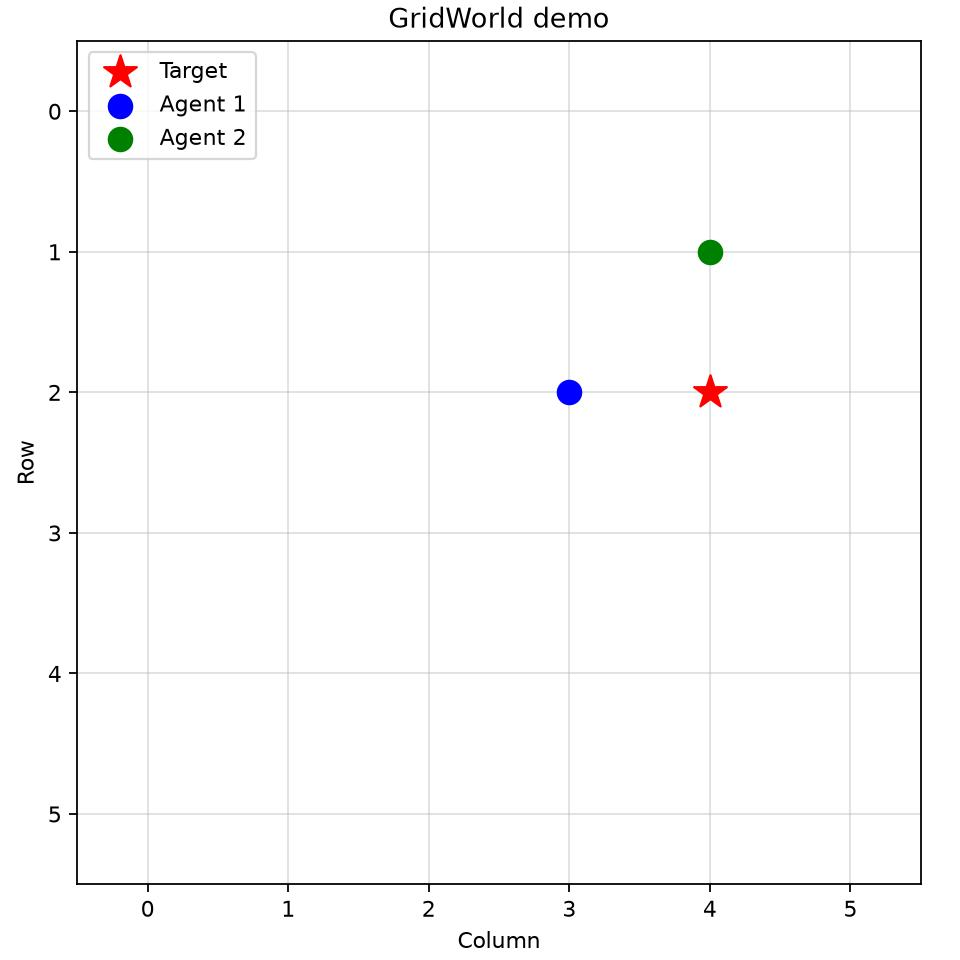

# mini-MAPPO

A small, educational implementation of **Multi-Agent PPO (MAPPO)** using
**Centralized Training, Decentralized Execution (CTDE)**.

This fork is intentionally being reorganized in small steps so it can later be
extended toward graph-attention MAPPO and temporal/belief-state memory without
turning one large script into a harder-to-follow implementation.

## What is MAPPO?

1. **Decentralized execution (Actor):** each agent chooses an action using only
   its local observation.
2. **Centralized training (Critic):** during training, the critic may use a
   global state to estimate value and provide a stronger learning signal.

The current demo shares one Actor across agents. The Critic receives the global
state and returns one value estimate per agent.

## Code map

- `mini_mappo/config.py` — experiment and PPO hyperparameters.
- `mini_mappo/environment.py` — GridWorld dynamics and the CTDE observation/state contract.
- `mini_mappo/networks.py` — Actor and centralized Critic neural networks.
- `mini_mappo/agent.py` — policy sampling, action evaluation, and model ownership.
- `mini_mappo/rollout.py` — on-policy trajectory storage and GAE.
- `mini_mappo/trainer.py` — rollout collection and PPO/MAPPO optimization.
- `mini_mappo/training_plots.py` — training progress figures and raw report export.
- `mini_mappo/visualization.py` — rendering only; no training logic.
- `main.py` — thin executable entry point.
- `tests/test_core.py` — small regression/smoke tests.

This separation is deliberate. Future steps can add graph construction, node
encoders, graph attention, and a temporal-memory module at clear boundaries.

## Data flow

```text
local observations -> shared Actor -> actions -> environment
                                          |
global state --------------------------> Critic
                                          |
Actor/Critic outputs + rewards -> RolloutBuffer -> GAE -> PPO update
```

## Bugs corrected during the modularization pass

The original single-file example was reviewed before refactoring. The following
issues were corrected while preserving the small educational scope:

- **Terminal-condition mismatch:** `GridWorldEnv.step()` ended an episode when
  *any* agent reached the target, while the training loop waited for *all*
  agents. Training now uses the environment's `done` signal consistently.
- **GAE mixed agents with time:** agent samples were flattened before GAE, so an
  agent at time `t` could be treated as the temporal predecessor of another
  agent at the same time. Rollouts now retain `[time, agent]` structure and GAE
  is computed independently along time for each agent.
- **Terminal bootstrapping:** rollout masks were always `1`, including terminal
  transitions. Terminal transitions now use a zero mask and do not bootstrap
  from a value beyond the episode.
- **Critic target ambiguity:** a scalar critic was trained against different
  per-agent returns for the same global state. The critic now has one centralized
  value head per agent.
- **Unused minibatch setting:** PPO updates now actually use the configured
  minibatch size.
- **Coordinate normalization:** grid coordinates now divide by
  `grid_size - 1`, mapping the full coordinate range to `[0, 1]`.

## Rollout and GAE

PPO is on-policy. `RolloutBuffer` records recent trajectories from the current
policy and then discards them after the PPO update. It is **not** a DQN-style
long-term replay buffer.

GAE is computed as

```text
delta_t = r_t + gamma * V(s_{t+1}) - V(s_t)
A_t = delta_t + gamma * lambda * A_{t+1}
return_t = A_t + V(s_t)
```

with terminal masking and a separate temporal sequence for each agent.

## PPO update

The update uses:

- clipped policy-ratio objective,
- fixed rollout advantages,
- centralized critic value loss,
- entropy regularization,
- multiple epochs and shuffled minibatches.

## Demo video

[](https://youtu.be/Fn9okCSeA1Q)

## Run

Run these commands from the repository root. Set up the environment once:

```bash
sudo apt install -y python3-venv python3-tk
python3 -m venv .venv
source .venv/bin/activate
python -m pip install --upgrade pip
python -m pip install -r requirements.txt
```

For each new terminal, activate the environment before running:

```bash
source .venv/bin/activate
python main.py
```

The real-time visualization needs a graphical display and a Matplotlib GUI
backend. On Ubuntu, `python3-tk` supplies Tkinter for the `TkAgg` backend; it is
a system package, not a pip requirement. Matplotlib selects a GUI backend
automatically when one is available; no environment variable is needed.
Under WSL, run from a session with WSLg GUI support. Check the window before
spending time training:

```bash
python -c "import matplotlib.pyplot as plt; plt.plot([0, 1]); plt.show()"
```

Close the test window to return to the terminal. If Matplotlib reports
`FigureCanvasAgg is non-interactive`, it selected the file-rendering `Agg`
backend. Install `python3-tk`, check the display, and retry `python main.py`.

Run the small regression suite with:

```bash
python -m unittest discover -s tests
```

### Training progress

After training, `python main.py` saves four separate progress figures and opens
them alongside the policy animation. Reports are written under
`logs/<YYYYMMDD>/training/<HHMMSS_microseconds>/`, relative to the repository:

- `team_return.png`: team return versus cumulative environment steps.
- `target_reaching_rate.png`: target-reaching rate versus cumulative environment steps.
- `episode_length.png`: episode length versus cumulative environment steps.
- `return_vs_time.png`: team return versus elapsed training seconds.
- `episodes.csv`: original measurements for each episode, including episode
  index, cumulative environment steps, team return, episode length, success,
  and elapsed seconds.
- `config.json`: configuration used for the run, including the smoothing window.

Each PNG contains one plot and can be opened directly in VS Code's image viewer.
One joint `env.step(actions)` counts as one environment step, regardless of the
number of agents. Team return is the undiscounted sum of rewards over agents
and timesteps. Success means **any** agent reaches the target; shorter episodes
alone do not establish that the policy is better.

Faint lines show individual episodes. Bold lines show trailing means over up to
`Config.progress_window` episodes (50 by default); early windows use only the
episodes available so far. These are stochastic training-rollout measurements
from one run, not separate evaluation scores or confidence intervals across
random seeds. Elapsed time covers rollout collection and PPO updates, excluding
initial model setup and plotting, and depends on hardware.

The environment-step axis and explicit smoothing follow
[Spinning Up's plotting conventions](https://spinningup.openai.com/en/latest/user/plotting.html).
Reward, success, episode length, and time are distinct metrics, consistent with
[Stable Baselines3's logging definitions](https://stable-baselines3.readthedocs.io/en/master/common/logger.html).
PPO loss curves are omitted here: the existing optimizer reports only the last
minibatch's losses, which would not represent an episode-wide mean.

If startup reports `Bus error (core dumped)`, isolate dependency loading with
`python -X faulthandler -c "import numpy; import torch; import matplotlib.pyplot"`.
A crash here happens before the training code runs. A partial dependency install
can leave truncated native libraries; repeating `pip install -r requirements.txt`
may leave them in place because their package versions are already installed.
Preserve the old `.venv` outside the repository, then repeat the setup commands
to create a clean environment. Close any processes using the old environment first.

## Next learning steps

The code is intentionally ready to grow in small increments. Natural next
modules are:

1. graph construction,
2. type-aware node encoders,
3. graph attention,
4. optional temporal memory / belief state,
5. graph-aware actor and centralized critic inputs.

The baseline should remain runnable at each step so new complexity can be
compared against the simpler MAPPO implementation.
