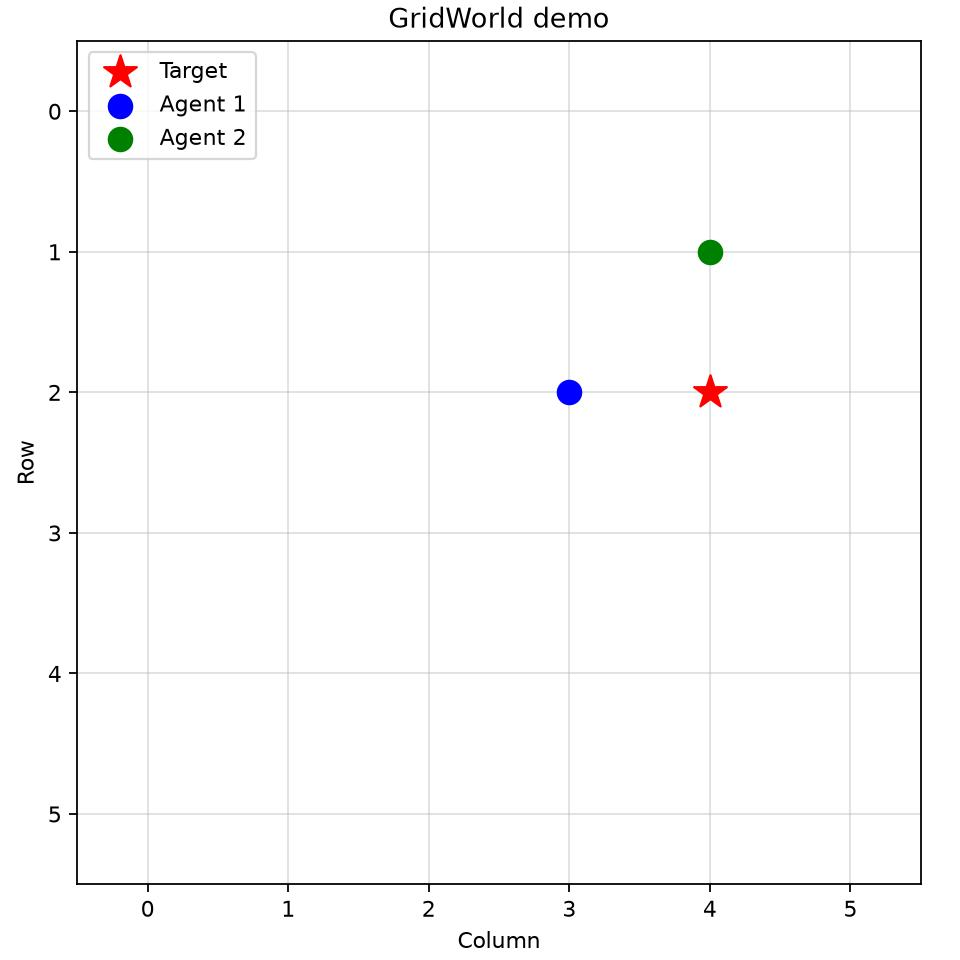

# mini-MAPPO

## Game Objective Description

Two agents move around a **6 × 6 grid** toward a stationary target, shown as a
red star. The goal is for **at least one agent to reach the target as quickly
as possible**. Both agents are trying to reach the same target; they are not
opponents, and both do not have to arrive for the attempt to succeed.

Each attempt is called an **episode**. At the start of an episode, the target
and agents are placed randomly, with neither agent starting on the target.
On each step, both agents choose to move up, down, left, right, or stay put.
Agents cannot leave the grid, but they can occupy the same cell.

- **Win:** At least one agent enters the target cell. The episode ends after
  that step, even if the other agent has not reached the target.
- **Fail:** Neither agent reaches the target within **50 steps**. The attempt
  times out and a new episode starts. Reaching the target on step 50 still counts
  as a win.
- **Scoring:** An agent earns a bonus for reaching the target. Otherwise, it
  loses points each step, with larger penalties when farther from the target.
  This encourages reaching the target promptly. A win can still have a negative
  total score because of penalties accumulated along the way.

That scoring rule describes the original **handcrafted** mode. The configurable
**preference_learned** mode keeps the same movement task and win/fail conditions,
but learns an outcome score from preferences instead of using distance penalties
for policy training. Both modes are described below.

Training repeats these attempts so the agents can learn better movement choices.
After training, the animation shows five fresh attempts using the learned policy.
The grid size, agent count, and step limit above are the example's defaults.

## About this example

A small, educational implementation of **Multi-Agent PPO (MAPPO)** using
**Centralized Training, Decentralized Execution (CTDE)**.

This fork is intentionally being reorganized in small steps so it can later be
extended toward graph-attention MAPPO and temporal/belief-state memory without
turning one large script into a harder-to-follow implementation.

## What is MAPPO?

1. **Decentralized execution (Actor):** each agent chooses an action using only
   its local observation.
2. **Centralized training (Critic):** during training, the critic may use a
   global state to estimate value and provide a stronger learning signal.

The current demo shares one Actor across agents. The Critic receives the global
state and returns one value estimate per agent.

## Code map

- `src/mini_mappo/config.py` — experiment and PPO hyperparameters.
- `src/mini_mappo/environment.py` — GridWorld dynamics and the CTDE observation/state contract.
- `src/mini_mappo/networks.py` — Actor and centralized Critic neural networks.
- `src/mini_mappo/agent.py` — policy sampling, action evaluation, and model ownership.
- `src/mini_mappo/rollout.py` — on-policy trajectory storage and GAE.
- `src/mini_mappo/trainer.py` — rollout collection and PPO/MAPPO optimization.
- `src/mini_mappo/training_plots.py` — training progress figures and raw report export.
- `src/mini_mappo/preference_rewards.py` — synthetic outcome comparisons and a learned terminal scorer.
- `src/mini_mappo/visualization.py` — rendering only; no training logic.
- `src/mini_mappo/__main__.py` — executable entry point for `python -m mini_mappo`.
- `tests/` — core and training-report regression tests.
- `pyproject.toml` — package metadata and Python dependencies.
- `configs/` — shared experiment settings, reward-mode selections, and their JSON Schema.

This separation is deliberate. Future steps can add graph construction, node
encoders, graph attention, and a temporal-memory module at clear boundaries.

## Data flow

```text
local observations -> shared Actor -> actions -> environment
                                          |
global state --------------------------> Critic
                                          |
Actor/Critic outputs + rewards -> RolloutBuffer -> GAE -> PPO update
```

## Bugs corrected during the modularization pass

The original single-file example was reviewed before refactoring. The following
issues were corrected while preserving the small educational scope:

- **Terminal-condition mismatch:** `GridWorldEnv.step()` ended an episode when
  *any* agent reached the target, while the training loop waited for *all*
  agents. Training now uses the environment's `done` signal consistently.
- **GAE mixed agents with time:** agent samples were flattened before GAE, so an
  agent at time `t` could be treated as the temporal predecessor of another
  agent at the same time. Rollouts now retain `[time, agent]` structure and GAE
  is computed independently along time for each agent.
- **Terminal bootstrapping:** rollout masks were always `1`, including terminal
  transitions. Terminal transitions now use a zero mask and do not bootstrap
  from a value beyond the episode.
- **Critic target ambiguity:** a scalar critic was trained against different
  per-agent returns for the same global state. The critic now has one centralized
  value head per agent.
- **Unused minibatch setting:** PPO updates now actually use the configured
  minibatch size.
- **Coordinate normalization:** grid coordinates now divide by
  `grid_size - 1`, mapping the full coordinate range to `[0, 1]`.

## Rollout and GAE

PPO is on-policy. `RolloutBuffer` records recent trajectories from the current
policy and then discards them after the PPO update. It is **not** a DQN-style
long-term replay buffer.

GAE is computed as

```text
delta_t = r_t + gamma * V(s_{t+1}) - V(s_t)
A_t = delta_t + gamma * lambda * A_{t+1}
return_t = A_t + V(s_t)
```

with terminal masking and a separate temporal sequence for each agent.

## PPO update

The update uses:

- clipped policy-ratio objective,
- fixed rollout advantages,
- centralized critic value loss,
- entropy regularization,
- multiple epochs and shuffled minibatches.

## Demo video

[](https://youtu.be/Fn9okCSeA1Q)

## Run

From the repository root, enter this project with `cd projects/mini_mappo`.
Run all commands below from that project directory. Set up its environment once:

```bash
sudo apt install -y python3-venv python3-tk
python3 -m venv .venv
source .venv/bin/activate
python -m pip install --upgrade pip setuptools
python -m pip install -e .
```

The editable install makes `src/mini_mappo` importable without setting
`PYTHONPATH`; source edits take effect immediately. Dependencies are defined
in `pyproject.toml`. Once installed, running and testing require no network.
If editable metadata needs reinstalling offline while dependencies and setuptools
are already available, use `python -m pip install --no-build-isolation --no-deps -e .`.

For each new terminal, activate the environment before running:

```bash
source .venv/bin/activate
python -m mini_mappo
```

### Choose the reward method

All experiment settings now come from versioned JSON files. The default is
`configs/handcrafted.json`; select the method explicitly with:

```bash
python -m mini_mappo --config configs/handcrafted.json
python -m mini_mappo --config configs/preference_learned.json
```

| Mode | Policy-training reward | Discount and episode boundary |
| --- | --- | --- |
| `handcrafted` | Original per-agent target bonus, remaining-distance penalty, and step penalty | Original `gamma=0.99`; timeout retains critic bootstrapping |
| `preference_learned` | Zero between steps; one learned outcome score shared by all agents at success or timeout | `gamma=1`; the finite attempt ends at success or timeout, without bootstrapping |

The learned mode first fits a two-feature linear reward model from **synthetic
outcome summaries**, not human judgments or executed demonstration trajectories.
The configured `reach_target_then_minimize_steps` objective prefers success over
failure, then shorter successful attempts. Equal-length successes tie, and all
failures tie. The features are success and the fraction of the time limit saved
by a successful attempt. Pairwise logistic training learns their weights; the
resulting score is frozen before PPO begins. Failure scores zero, and fastest
success is normalized to one. These numerical anchors establish a convention,
not an absolute measure of mission value or cost.

The pairwise reward-learning approach follows
[learning rewards from preferences](https://arxiv.org/abs/1706.03741);
the two-feature terminal scorer and synthetic outcome provider are deliberately
small adaptations for this example.

The model holds out every `preference_holdout_stride`-th successful length from
fitting. Its validation pairs contain at least one held-out successful length;
some pair partners are training outcomes. `reward_fit.json` reports this split
and strict preference accuracy. This small example demonstrates reward learning
over outcome summaries; it is not human-feedback RL or graph-attention MAPPO.

`configs/base.json` contains common settings, including seed, network size,
training budget, reward coefficients, fit settings, plotting, and policy
visualization. Each method file extends that base and selects its mode and
discount. The learned preset also uses 3,000 episodes, eight episodes per PPO
update, minibatches of 128, and `gae_lambda=0.98`. The handcrafted preset keeps
600 episodes and one episode per update. Both use `advantage_normalization="batch"`.
These are starting settings to evaluate, not measured improvements. See the
[configuration reference](docs/configuration.md) for every parameter's purpose,
direction of effect, and tradeoffs, including the `batch`, `minibatch`, and `none`
normalization choices. To make another experiment file, extend `base.json`
directly and override the settings you want; inheritance has one level. JSON Schema field
descriptions document units and meaning. Relative `--config` paths resolve from
the project directory, even when launching elsewhere; relative `extends` paths
resolve from the containing JSON file. Resolved settings are validated before a
run starts. Python callers use `config.load_config()` instead of `Config()`.

To save plots without desktop windows or the animation, set `show_plots` and
`visualize_policy` to `false` in the selected configuration or shared base.
Each method runs separately; no comparison analysis script is included yet.

For later comparison, keep seeds and common task/budget settings matched. Use
target-reaching rate and steps to successful completion, not absolute training
returns: the reward scales differ. These initial mode configurations also differ
in discount, timeout treatment, training budget, and PPO settings; they are not a
reward-only ablation. Seeds are recorded, but identical GPU execution across
different systems is not guaranteed.

The real-time visualization needs a graphical display and a Matplotlib GUI
backend. On Ubuntu, `python3-tk` supplies Tkinter for the `TkAgg` backend; it is
a system package, not a pip requirement. Matplotlib selects a GUI backend
automatically when one is available; no environment variable is needed.
Under WSL, run from a session with WSLg GUI support. Check the window before
spending time training:

```bash
python -c "import matplotlib.pyplot as plt; plt.plot([0, 1]); plt.show()"
```

Close the test window to return to the terminal. If Matplotlib reports
`FigureCanvasAgg is non-interactive`, it selected the file-rendering `Agg`
backend. Install `python3-tk`, check the display, and retry `python -m mini_mappo`.

Run the small regression suite with:

```bash
python -m unittest discover -s tests
```

### Debugging in VS Code

Open the `marl-examples` repository root in VS Code, using a WSL window for
this Linux environment. Install the recommended Microsoft Python and Python
Debugger extensions in WSL. The repository's `.vscode/launch.json` selects
this project's virtual environment and launches `python -m mini_mappo`.
The additional **mini_mappo: preference_learned** configuration selects the
learned-reward JSON file; the original debugger entry selects handcrafted mode.

1. Open a source file under `src/mini_mappo/` and click the gutter to the left
   of an executable line number to set a breakpoint (or press **F9**).
2. Open **Run and Debug** (**Ctrl+Shift+D**) and select
   **mini_mappo: train and visualize**.
3. Press **F5** to start. Execution pauses before the breakpoint's statement.
4. Use **F10** to step over, **F11** to step into your functions,
   **Shift+F11** to step out, and **F5** to continue. Inspect values in
   **Variables**, **Watch**, or by hovering over a variable.

The configuration uses `justMyCode: true` to keep stepping focused on project
code. Breakpoints should be placed on executable statements rather than comments
or decorators; `select_action()` in `agent.py` is a useful starting point.

### Training progress

After training, `python -m mini_mappo` saves four separate progress figures and opens
them alongside the policy animation. Reports are written under
`outputs/<YYYYMMDD>/<HHMMSS_microseconds>_<reward_mode>_seed<seed>/`, relative to this project:

- `plots/team_return.png`: mode-specific training return versus cumulative environment steps.
- `plots/target_reaching_rate.png`: target-reaching rate versus cumulative environment steps.
- `plots/episode_length.png`: episode length versus cumulative environment steps.
- `plots/return_vs_time.png`: team return versus elapsed training seconds.
- `episodes.csv`: original measurements for each episode, including episode
  index, cumulative environment steps, team return, episode length, success,
  and elapsed seconds.
- `config.json`: configuration used for the run, including the smoothing window.
- `summary.json`: versioned results with mode, seed, success rate, mean steps to
  success (null if none succeeded), and training-return diagnostics.
- `run.json`: reward-setup time, compute device, library/Python versions, and
  a fingerprint of the Python source used for the run.
- `policy.pt`: final actor and critic weights.
- Learned mode additionally saves `reward_model.pt`, `preference_pairs.csv`,
  and `reward_fit.json` to preserve its scorer, synthetic labels, and fit evidence.

Each PNG contains one plot and can be opened directly in VS Code's image viewer.
One joint `env.step(actions)` counts as one environment step, regardless of the
number of agents. The CSV's `team_return` is the summed per-agent episode reward
in handcrafted mode and the shared learned outcome score reported once in
learned mode. Each agent receives that same score during learned-mode training.
`handcrafted_return` records the original reward formula in both modes as a
diagnostic; `learned_score` is populated only in learned mode. Success means
**any** agent reaches the target; shorter episodes
alone do not establish that the policy is better.

Faint lines show individual episodes. Bold lines show trailing means over up to
`Config.progress_window` episodes (50 by default); early windows use only the
episodes available so far. These are stochastic training-rollout measurements
from one run, not separate evaluation scores or confidence intervals across
random seeds. Elapsed time covers rollout collection and PPO updates, excluding
initial model setup, reward fitting, and plotting, and depends on hardware.
The separately recorded reward-setup time should be included when comparing
total training cost. These are training-rollout metrics, not held-out policy evaluation.

The environment-step axis and explicit smoothing follow
[Spinning Up's plotting conventions](https://spinningup.openai.com/en/latest/user/plotting.html).
Reward, success, episode length, and time are distinct metrics, consistent with
[Stable Baselines3's logging definitions](https://stable-baselines3.readthedocs.io/en/master/common/logger.html).
PPO loss curves are omitted here: the existing optimizer reports only the last
minibatch's losses, which would not represent an episode-wide mean.

If startup reports `Bus error (core dumped)`, isolate dependency loading with
`python -X faulthandler -c "import numpy; import torch; import matplotlib.pyplot"`.
A crash here happens before the training code runs. A partial dependency install
can leave truncated native libraries; repeating `python -m pip install -e .`
may leave them in place because their package versions are already installed.
Preserve the old `.venv` outside the repository, then repeat the setup commands
to create a clean environment. Close any processes using the old environment first.

## Next learning steps

The code is intentionally ready to grow in small increments. Natural next
modules are:

1. graph construction,
2. type-aware node encoders,
3. graph attention,
4. optional temporal memory / belief state,
5. graph-aware actor and centralized critic inputs.

The baseline should remain runnable at each step so new complexity can be
compared against the simpler MAPPO implementation.
